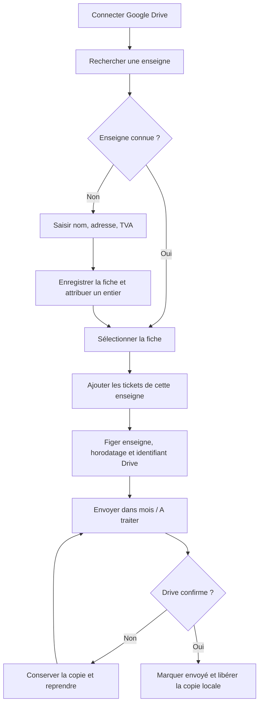
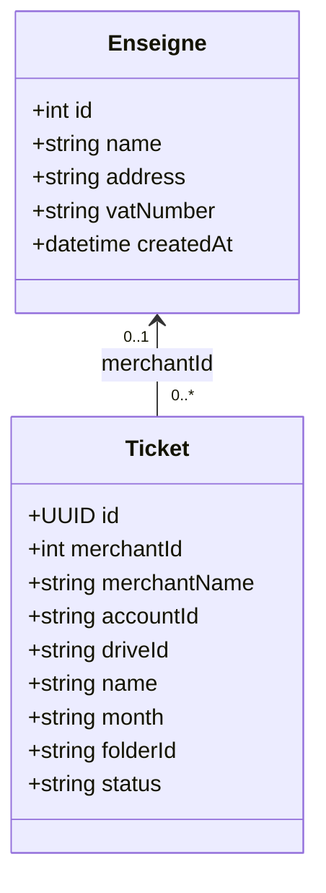

# Tickets de caisse — dossier d’analyse fonctionnelle

Version du 15 octobre 2026.

## Besoin et rôle de l’analyste fonctionnel

L’utilisateur souhaite déposer une preuve d’achat à traiter, déjà rattachée au bon magasin ou restaurant. Le travail d’analyse consiste à transformer ce besoin en parcours, règles de gestion, données et critères de recette vérifiables : le ticket est-il associé à une enseigne existante ? Quand l’association devient-elle stable ? Que faire en cas de coupure ou de changement de compte ?

Le besoin et le choix d’un répertoire partagé via Drive ont été précisés par Loïc. La réalisation et les tests automatisés ont été effectués avec l’assistant. La recette avec le vrai compte Google reste à effectuer par l’utilisateur.

## Périmètre et décisions

- Une enseigne comporte nom, adresse, numéro de TVA et identifiant entier généré à la création. Nom, adresse et TVA sont requis ; aucune validation fiscale de la TVA n’est annoncée.
- La liste filtre une sous-chaîne du nom, sans casse ni accents. Une simple saisie ne vaut pas sélection. Les homonymes sont distingués par l’adresse et l’ID.
- Le répertoire est propre au compte Google et partagé entre appareils dans `enseignes.json`.
- Le classement mensuel est conservé : `tickets de caisses/yyyy.MM/A traiter`.
- Une sélection correspond à un lot de nouveaux tickets. Les reprises gardent l’enseigne déjà attribuée.
- L’OCR, la modification/suppression d’enseignes et le traitement comptable des tickets restent hors périmètre.

## Règles de gestion

| Référence | Règle | Critère observable |
|---|---|---|
| RG-01 | Une enseigne sélectionnée est obligatoire à l’envoi. | Le bouton est désactivé sans sélection ; le traitement contrôle aussi la présence de l’ID. |
| RG-02 | Les IDs sont des entiers de 1 à 999999, sans réemploi. | Une création prend `nextId`, puis incrémente ce compteur dans une écriture conditionnelle. |
| RG-03 | Le nom commence par l’ID sur six chiffres. | ID 42 → `000042.2026.09.12.091530.398.jpg`. |
| RG-04 | Le ticket va dans le mois du premier envoi, sous `A traiter`. | Le parent Drive est le sous-dossier de ce mois. |
| RG-05 | L’association est stable après le premier début d’envoi. | Une nouvelle sélection ne réaffecte pas un transfert interrompu. |
| RG-06 | La copie locale reste jusqu’à confirmation de Drive. | Après coupure, le fichier peut être renvoyé et garde son identifiant Drive. |
| RG-07 | Les données sont isolées par compte. | Changer de compte vide la sélection et recharge le répertoire correspondant. |
| RG-08 | Une modification concurrente ne doit pas écraser une fiche. | Réponse 412 → relecture et nouvel essai ; limite de cinq tentatives. |
| RG-09 | Les tickets déjà confirmés ne sont pas déplacés automatiquement. | Seules les nouvelles créations et reprises en attente utilisent le nouveau parcours. |

## Processus

Le diagramme ci-dessous est un logigramme de lecture du processus. La fiche du site local présente sa représentation BPMN, avec couloirs, passerelles exclusives et échanges avec Drive.

## Modèle UML

La multiplicité `0..1` couvre le brouillon importé avant sélection. Elle devient **exactement 1 dès le premier envoi**. `merchantName` est une copie d’affichage ; `merchantId` porte la relation durable. Sur Drive, `appProperties.merchantId` contient sa représentation textuelle, comme l’exige ce format de métadonnées.

## Testing et traçabilité

| Vérification | Règles | Preuve et résultat au 15/10/2026 |
|---|---|---|
| Nom, bornes d’ID, recherche, champs requis, répertoire invalide | RG-01 à RG-03 | `tests/core.test.js` : réussi |
| Répertoire partagé, conflit 412, réponse perdue, pagination | RG-02, RG-07, RG-08 | Réponses Drive simulées : réussi |
| Dossier, métadonnées, reprise et migration d’un ancien envoi | RG-03 à RG-06, RG-09 | Réponses Drive simulées : réussi |
| Création, sélection clavier, bouton bloqué sans choix | RG-01, RG-02 | `tests/browser.test.js` : réussi |
| Coupure, rechargement, reprise, historique, mobile et changement de compte | RG-04 à RG-07 | Navigateur Edge avec Drive simulé : réussi |
| OAuth, écritures conditionnelles réelles, initialisation sur deux appareils et contenu reçu | RG-02, RG-04, RG-06, RG-08 | À réaliser avec le compte Google autorisé avant publication |

Les tests automatisés ne prouvent pas le fonctionnement des permissions réelles de Google. La recette finale doit créer deux enseignes depuis des appareils distincts, vérifier leurs IDs et leurs fiches, envoyer un ticket et contrôler son fichier, son parent, sa propriété `merchantId`, puis interrompre et reprendre un second transfert.
